# DeepSeek Android App 改进方案（阶段 C 研究更新）

日期：2026-11-17；阶段 C 研究更新：2026-11-22（Asia/Singapore）。

初始盘点基线：`develop` / `5d5dd75` / chat-demo `0.1.1`；本次研究基线：`develop` / `981428e` / `0.1.3`。
状态：阶段 A（工程基础）已于 `3203949` 实施——Capacitor 8 工程、平台适配层、CI 门禁已入库，调试 APK 可构建安装。2026-11-18 复核后将 **Keystore 凭据加密与草稿持久化划入阶段 A**（原排期在 B），随安全存储插件与草稿落盘一并实施；四链路验证进度与剩余条件见[阶段 A 验证记录](android-phase-a-verification.md)。**阶段 B（日常使用闭环）已于 `0240d6b` 实施（2026-11-19~21）**：模型选择与思考强度、余额与用量面板、完整应用备份（归档 v4）、附件图片全屏查看、双击退出与预测性返回结论、长对话性能测量与虚拟化决策（按需渲染富内容优先于列表虚拟化）；验证记录见[阶段 B 验证记录](android-phase-b-verification.md)与[阶段 B 性能报告](android-phase-b-perf.md)。

## 1. 建议与目标

建议先用 **Capacitor 容器复用现有 React 客户端，通过 Kotlin 平台模块补齐 Android 能力**。先做有明确通过条件的技术验证，再决定是否沿这条路线进入产品实现。保留 Messages 协议作为主聊天通道，无需为了“接入新 API”先重写整套聊天逻辑。

目标是让用户在 Android 上完成日常 DeepSeek 使用：文字与深度思考、搜索和读链接、图片和文档问答、语音输入与朗读、可靠保存历史及迁移。以个人 API Key 和本地数据为初版使用方式。官方账号的会话同步、免费额度、订阅、计费和其他账号能力不等于开放 API 能力，不能承诺自动继承。

初始盘点时（2026-11-17）Demo 已实现上述多项 Web 功能，尚无 APK 工程。阶段 A/B 已补 Android 工程及多项模拟器验证，真机剩余项仍见对应记录。详细代码依据见[项目设计审查](project-design.md)；协议依据见[本地官方文档](deepseek-api/README.md)。

## 2. 当前基础与优先改进

下表保留 2026-11-17 的初始差距与优先级；当前完成情况以阶段 A/B 验证记录及[阶段 C 推进方案](android-phase-c-plan.md)为准。

| 方面 | 当前基础 | 建议变化 | 优先级 |
| --- | --- | --- | --- |
| 应用载体 | React 静态网页，有响应式布局 | 增加 Android 工程、签名、安装和升级流程，打包本地资源 | P0 |
| 聊天协议 | Messages + SSE，含搜索/读链接/标题/安全扩展 | 维持协议，抽出可替换的流式传输；形成基于新文档的契约检查 | P0 |
| 凭据 | API Key 明文 localStorage | 使用 Keystore 管理加密密钥，API Key 密文放应用私有存储 | P0 |
| 数据可靠性 | IndexedDB v11，会话按需加载；草稿仅内存 | 增加草稿和恢复状态持久化、升级迁移、存储失败提示及备份策略 | P0 |
| 附件 | 图片/文档上传、服务端 file_id、本地原件 | 系统文件选择，内容 URI 适配，明确解析方式/计费/远端保留与删除 | P0 |
| 语音 | Web Audio 录音、ASR、HTTP PCM 朗读 | 权限、前后台释放、音频焦点/中断、原生播放或录音适配 | P0 |
| 移动交互 | 窄屏布局、visualViewport、侧栏抽屉 | 返回键、IME/insets、状态栏、横竖屏、TalkBack、文字缩放 | P0 |
| 模型与费用 | 默认模型固定 Flash，已有部分 usage 记录 | 能力驱动选择模型与思考强度；余额/消耗展示及重复费用保护 | P1 |
| 历史迁移 | 兼容格式 ZIP，导入替换全部 | 保留兼容入口，增加完整应用备份，先备份再覆盖并支持失败恢复 | P1 |
| 长对话 | 当前分支全部消息 DOM 渲染 | 真机测量后按瓶颈优化列表、Markdown、图表与大附件处理 | P1 |
| 独立工具 | 没有完整 Search/Fetch/OCR 工具页面 | 有明确场景再增加，避免与已存在的服务端聊天工具重复建设 | P2 |

P0 指形成可靠 Android 使用闭环所需；P1 指之后补齐；P2 指可选扩展。这里的优先级不是实现完成状态。

## 3. 技术路线比较与决策门槛

| 路线 | 可复用内容 | 主要成本 | 判断 |
| --- | --- | --- | --- |
| Capacitor + React + Kotlin 平台模块 | DOM/CSS、消息树、状态、SSE 解析、Markdown/KaTeX/Mermaid、历史交换格式 | WebView 兼容、平台桥接、生命周期和存储语义 | 首选候选，先验证 |
| Kotlin + Jetpack Compose | 产品交互、API 契约、数据交换格式 | UI、状态、网络、数据库及富文本渲染大部分重写 | 若容器路线达不到可靠性/性能目标再评估 |
| React Native | 纯 TS 领域逻辑、部分状态与协议 | React DOM/CSS、IndexedDB、Web Audio 和富文本层不能直接照搬 | 对当前基础，首轮收益不及 Capacitor 明确 |

这是基于本项目复用范围的工程判断，不是三种框架在所有场景下的性能排名。React Native 与 Compose 的定位见[React Native 核心组件](https://reactnative.dev/docs/intro-react-native-components)、[Android Compose](https://developer.android.com/compose)。

### 3.1 必须先验证的四条链路

1. **网络**：真实 APK 内从首次请求到 SSE 增量显示、停止、工具结果、拒答与断流。验证本地 origin、CORS、预检和文件上传，不以浏览器或桌面成功代替。
2. **语音**：麦克风授权/拒绝、短录音到 ASR、TTS 首帧播放与停止、耳机/来电/切后台后的资源释放。
3. **数据**：Keystore 加密凭据的重启读取、会话/草稿持久化、强杀恢复、安装升级后历史保留、备份恢复。
4. **文件**：SAF 选择 PDF/图片、云盘提供方 `content://`、上传解析、导出 ZIP 保存及外部分享，覆盖取消与失败。

四条都取得真实 API 和目标设备证据后，才将路线状态改为“已验证可实施”。如某一项失败，先隔离问题，验证 Kotlin 平台适配能否补齐；只有补齐成本或效果不可接受时才重新评估全面原生重写。

## 4. 建议架构

```mermaid
flowchart TD
  UI[现有 React 界面与富文本] --> Domain[聊天领域：消息树 / 会话 / 请求编排]
  Domain --> DeepSeek[DeepSeek 适配：Messages / Files / ASR / TTS]
  DeepSeek --> Transport[流式传输接口：增量 / 取消 / 超时 / 错误]
  Domain --> Data[会话与附件仓库接口]
  UI --> Platform[文件 / 分享 / 录音播放 / 生命周期接口]
  Transport --> Native[Kotlin 平台实现或经验证的 WebView 实现]
  Data --> Native
  Platform --> Native
  Native --> OS[Android Keystore / 私有存储 / SAF / 音频 / 系统生命周期]
  Native --> API[DeepSeek 官方 API]
```

平台调用集中在适配层，聊天领域不直接依赖 Capacitor 全局对象。Web 开发继续使用浏览器实现；Android 提供经验证的原生或 WebView 实现。传输接口必须保留分块顺序、结束标识、取消传播、HTTP/流内错误和二进制音频能力。

阶段 A 已新增 `src/platform/` 和 `android/`，平台调用在适配层收口；网络仍使用经模拟器验证的 WebView fetch。阶段 C 按测量结果再决定是否扩展原生模块。初版不需要自建应用后端：用户凭个人 Key 访问官方服务。若以后转为开发者统一付费、多用户服务或云同步，再独立设计服务端身份、凭据和数据隔离。

### 4.1 网络与打包

- APK 内打包 `dist`，固定本地 origin。生产不加载开发服务器地址；origin 变化可能导致 localStorage/IndexedDB 看起来为空，需要显式迁移。
- 优先验证现有 WebView `fetch`，包括文件 multipart 和 SSE 长连接。不要直接全局开启原生 HTTP patch 并假定兼容流：CapacitorHttp 公布的是 `Promise<HttpResponse>`，没有与现有 `ReadableStream` 相同的增量契约。
- 如需原生传输，用 Kotlin 实现增量读取并有节制地向 JS 批量发送事件，保留现有协议解析；对聊天 SSE 和 TTS 字节流分别验收。避免把大文件或完整音频反复 base64 穿过桥接。
- 区分等待连接/首帧/持续无数据/用户停止；支持保活注释与慢解析。已返回部分回答、上传解析结果不明或服务端可能已处理时，不静默重放付费请求。
- 外部来源链接用系统浏览器打开，Markdown、图表和引用展示不因此获得任意本地文件或原生桥接访问能力。

依据：[Capacitor 配置](https://capacitorjs.com/docs/config)、[CapacitorHttp](https://capacitorjs.com/docs/apis/http)、[Android 包内内容加载](https://developer.android.com/develop/ui/views/layout/webapps/load-local-content)、[DeepSeek 保活与限速](deepseek-api/snapshot-2026-11-17/pages/zh-cn/quick_start/rate_limit.md)。

### 4.2 凭据与本地数据

Keystore 保存用于加密的密码学密钥；API Key 经加密后存应用私有位置。普通偏好可使用 Preferences，聊天和附件单独存储。Keystore 不直接等同于任意字符串保险箱，也不能保证运行期间绝无明文。原生传输若需要 Key，优先由原生层读取，避免不必要地把 Key 暴露给页面、日志和错误报告。

先保留 IndexedDB 并验证容量、升级保留和失败恢复；无法满足要求时再迁至 SQLite，迁移要有版本化步骤及可恢复备份。尤其要处理现有 Web 数据源和新 App origin 不同、旧数据库版本处理、文件引用与本地原件完整性。浏览器历史通过用户导出 ZIP 迁移，不能假定 App 自动读取浏览器数据目录。

把未发送文本和附件关联、当前会话、保存失败提示持久化；对生成中的回答定期保存恢复点。进程被回收后把任务显示为“已中断”，保留已收到内容，不自动重发。备份应区分“兼容官方格式的历史交换”和“包含全部本地附件及元数据的应用完整备份”，完整备份默认不包含 Key，另行明确加密、恢复和清除行为。

依据：[Android Keystore](https://developer.android.com/privacy-and-security/keystore)、[Capacitor Preferences](https://capacitorjs.com/docs/apis/preferences)、[当前历史格式](../src/services/chat/history/README.md)。

### 4.3 文件和语音

文件选取与导出使用系统 SAF，处理 `content://`、提供方授权及取消；私有附件和临时导出分别管理。分享使用 FileProvider/临时 URI 权限。选择附件后应明确何时开始上传和计费；服务端文档解析成功后即计费，中途离开不保证取消服务端处理。支持远端文件查看/删除之前先设计引用关系，避免删掉仍被其他会话引用的文件。

语音初版建议限定前台输入与朗读，先完成麦克风权限、AudioContext/原生音频、音频焦点和中断释放。现有 ASR 是整段录音后上传，官方接口不是流式 ASR；不要把它描述为实时双向语音。后续可评估 TTS WebSocket 的边生成边朗读，但这需要独立处理鉴权、片段切分、结束/错误、取消及计费上限。

依据：[SAF](https://developer.android.com/training/data-storage/shared/documents-files)、[安全分享文件](https://developer.android.com/training/secure-file-sharing)、[WebView 录音权限](https://developer.android.com/reference/android/webkit/PermissionRequest)、[前台服务限制](https://developer.android.com/develop/background-work/services/fgs/restrictions-bg-start)、[官方 ASR](deepseek-api/snapshot-2026-11-17/pages/zh-cn/guides/asr.md)、[官方 TTS](deepseek-api/snapshot-2026-11-17/pages/zh-cn/guides/tts.md)。

### 4.4 生命周期、交互与兼容范围

处理系统返回：优先关闭键盘、弹层、搜索面板和侧栏，再决定导航/退出行为。协调 Android IME/insets 与现有 `visualViewport`，避免双重补偿；验证安全区、横竖屏、分屏、文字缩放、TalkBack 和手势返回。前后台切换及时保存；不能依靠 `pagehide` 保证进程被杀前执行。

初版建议以 **Android 10+、经过验证的现代 System WebView** 为候选支持范围，最终随目标设备和技术验证确定。Android 系统版本、WebView 版本、minSdk、targetSdk 是不同约束。当前 Capacitor v8 文档的框架底线为 API 24+ / WebView 60+，而本项目构建目标是 Chrome 105+，不能据前者直接承诺旧 WebView 可运行。实施时锁定 Capacitor/JDK/Android SDK 版本，发布前再核对发行渠道对 targetSdk 的当期要求。

依据：[Capacitor Android](https://capacitorjs.com/docs/android)、[构建环境](https://capacitorjs.com/docs/getting-started/environment-setup)、[应用生命周期](https://capacitorjs.com/docs/apis/app)、[Android 输入法](https://developer.android.com/develop/ui/views/touch-and-input/keyboard-input/visibility)。

## 5. 新 API 的取舍与协议核对

完整 API 资料不等于必须把所有接口放进 App。以用户需要的聊天能力为主，按场景增加封装。

| 官方能力 | 当前代码 | 初步安排 |
| --- | --- | --- |
| Messages 与服务器完成的搜索/读链接/引用 | 已有请求与块渲染 | 作为主协议，补真实组合验收与断流恢复 |
| Files 与文件解析 | 已有 Anthropic 上传和 file_id 引用 | 提供文字解析/图文解析选择、状态和费用提示；补全远端文件生命周期 |
| ASR、HTTP TTS | 已有 | 优先做 Android 平台适配；保留官方格式/大小/时长限制 |
| TTS WebSocket | 未接入 | P2 评估连续朗读，不阻塞首版 |
| 模型列表与余额 | 阶段 B 已有模型能力选择、余额与用量 UI | 阶段 C 验证千会话统计性能；估算不作为完整账单 |
| Responses / Chat Completions | 无完整聊天适配 | 保留资料，外部兼容需求出现时再做，避免首版维护三份协议 |
| 独立 Search / Fetch | 聊天已用服务端工具，未直接封装 | 独立检索/阅读模式有需求时再接入 |
| 独立 OCR | 未接入 | 拍照提取文字或离线保留识别结果场景再接入；区别于问答附件解析 |
| JSON / 客户端函数工具 / FIM / 前缀续写 | 只有受限继续生成等部分能力 | 面向明确任务再开放；不把原始 API 参数全部堆入聊天设置 |

落地前至少核对以下细节：

1. **模型能力不同**：当前资料中 Flash 支持视觉，V4 Pro 不支持。切到 Pro 时应明确处理图片/图文附件，不允许静默丢图后继续。模型名、上下文和价格以最新资料核对，不沿用过时的 `deepseek-chat` / `deepseek-reasoner` 经验。
2. **思考参数按协议对应**：Messages 的 `thinking` 与 `output_config.effort`、Responses 的 `reasoning` 不是同一字段。新增 low/high/max 时保存每轮实际参数，不只保存一个全局开关。
3. **旧注释需要修正**：`api/types.ts` 仍写扩展模式不支持 document；本次官方文档已描述 document 输入及文档图片安全审核。后续以新契约纠正文案/类型并验收“文档 + 安全 + 搜索/读链接”组合，本轮不凭静态文档声称真实服务已通过。
4. **服务端工具上下文有特定规则**：思考签名、`read_link` 结果的 `signature`、历史块回传、继续生成限制分别核对，不能把另一种协议的工具往返规则机械套用。
5. **成功状态与费用不同步**：文档解析中断后仍可能完成并计费；ASR、TTS、搜索/抓取有各自费用与限速，不能只按输出 token 推算全部账单。收到 429、余额不足或模糊网络错误时，区分可重试与可能重复收费的情况。
6. **附件按最终请求聚合检查**：当前草稿最多 50 个附件不等于服务端允许每次 50 个文档。归档文档给出的请求级约束包括最多 20 个文档、合计 8 MiB 文档文字，并涉及分支历史引用；上传文件大小、解析后大小、图片数量应分别处理，不能只检查当前草稿。
7. **已有文件自愈也要检查费用**：当前代码在符合条件的 file_id 失效错误后会自动重新上传。文档重新解析可能再次计费，原聊天返回 400 不代表整个自愈流程免费；后续应把该路径纳入费用提示和重复上传控制。

依据：[模型与价格](deepseek-api/snapshot-2026-11-17/pages/zh-cn/quick_start/pricing.md)、[Anthropic 兼容](deepseek-api/snapshot-2026-11-17/pages/zh-cn/guides/anthropic_api.md)、[思考模式](deepseek-api/snapshot-2026-11-17/pages/zh-cn/guides/thinking_mode.md)、[文件解析](deepseek-api/snapshot-2026-11-17/pages/zh-cn/guides/document_parsing.md)、[联网工具](deepseek-api/snapshot-2026-11-17/pages/zh-cn/guides/web_tools.md)。

## 6. 分阶段实施及验收

### 阶段 A：技术验证与工程基础（已实施）

交付可安装的调试 APK、锁定的构建环境、平台接口最小骨架，以及四条链路的验证记录。把构建脚本改为 Windows 可运行，增加 develop/PR 的类型检查、lint、Web 和 Android 构建门禁；部署 Pages 与质量检查分开。

通过条件：目标设备真实调用得到 SSE 增量且能取消；真实文件能在问答中使用；ASR/TTS 可用并正确释放；凭据/历史在重启和覆盖安装后保留；ZIP 能经系统文件入口导入导出。每项记录设备、Android/WebView、应用构建版本、参数、输入样例与结果；失败项不能以桌面结果替代。

### 阶段 B：日常使用闭环

实现安全凭据、草稿与回答中断恢复、系统返回和键盘、文件/分享、前台语音、存储错误与权限拒绝恢复。保留现有分支、重生成、停止、标题、搜索引用和 Markdown 能力。提供模型能力检查、必要的费用提醒与远端文件清理策略。

通过条件：安装→设置 Key→导入历史→文字/图片/文档对话→搜索读链接→语音→重启恢复→备份导出，全流程真机通过；401/余额不足/429/断网/拒答/文件失效/存储写入失败均有可理解且不丢历史的处理。

### 阶段 C：性能、可访问性与功能补齐

2026-11-22 已完成源码研究、C0 工具与离线模拟器基线，包括 trace、20 轮内存及大备份闭环；2026-11-23 完成并验证 C1 富内容按需渲染（混合会话热切换中位 40.1→1.69 秒），同日补齐 C4 附件上下文与费用保护的代码和自动回归。2026-11-24 实施 C2 首批可访问性/移动适配并补浏览器和模拟器验证；C3 功能、TalkBack、C4 真实收费/设备链路与目标真机验收待推进。结果见[C0 测量记录](android-phase-c0-baseline.md)与[阶段 C 验证记录](android-phase-c-verification.md)，详细任务、源码依据、设备目标和验收方法见[阶段 C 推进方案](android-phase-c-plan.md)。

推进顺序：**C0 校准测量与建立当前基线 → C1 富内容按需渲染、C2 可访问性修复 → C3 标题检索与正文/分支定位**；C4 附件上下文与费用保护承接 B 遗留项并行补齐。完整备份和基础用量统计已在 B 完成，C 只做规模验证与必要优化。OCR、独立 Search/Fetch、WebSocket 朗读保留为可选项。

阶段 B 的历史测量显示重内容渲染成本突出，但当前夹具计数和指标口径需要先校准；不能直接把旧结果作为当前版本实测。优先真正延迟屏外高亮、公式排版与图表挂载，CSS `content-visibility` 作为对照，再决定列表虚拟化、数据库调整或原生模块扩展。

首轮保留 300 条消息、1,000 个会话摘要、长代码/公式/Mermaid 和合法大附件，增加分支定位及超过 100 MiB 本地归档，覆盖较低性能与日常主力设备。通过条件：新基线和优化对照可复现，冻结与滚动达到记录的设备目标，键盘/TalkBack/大字体完成主要流程，检索可定位未选分支，大备份和统计规模验证通过；尚无目标设备证据时保持待验。

### 阶段 D：发布准备

固定应用 ID 与签名密钥保管方式，完善版本号、升级/回退与数据备份、图标名称、隐私说明、许可证和离线可用边界。先产出用户可侧载的签名 APK；是否面向应用商店及对应材料另行确定。正式发布前以当期官方要求核对目标 SDK 和分发规则。

通过条件：签名构建可复现、覆盖安装保留数据、从上一正式版本迁移成功、用户手动验收通过；若未测旧设备、后台能力或商店发布，应明确写出范围。

## 7. 审阅时建议确定的产品决策

| 决策 | 当前建议 | 改变时的影响 |
| --- | --- | --- |
| 首轮实现路线 | Capacitor 技术验证后决定 | 直接原生需要更大重写范围 |
| 使用方式 | 个人 Key，本地会话，无自建后端 | 多用户统一计费/云同步需要额外服务端设计 |
| 支持设备 | 暂以 Android 10+ 和现代 WebView | 更旧设备需要扩大兼容与性能验证 |
| 首版语音 | 前台录音与朗读 | 后台持续运行需要服务、通知和独立验收 |
| 模型 | 默认 Flash，Pro 按能力开放 | 图片和文档能力必须随模型限制 |
| 历史迁移 | 用户导出 ZIP 后导入 | 自动同步官方账号不属于现有开放能力证明 |
| 分发方式 | 先签名 APK 侧载 | 商店分发需补相应发布材料和检查 |

以上产品决策保留原始建议，阶段 A/B 的实际实现与验收范围见对应记录。C0 已形成离线模拟器基线，C1/C4 与 C2 首批代码的当前证据见验证记录，下一批按[阶段 C 推进方案](android-phase-c-plan.md)推进 C3 并补设备验收；目标设备与阶段 D 发布条件另行验收。
