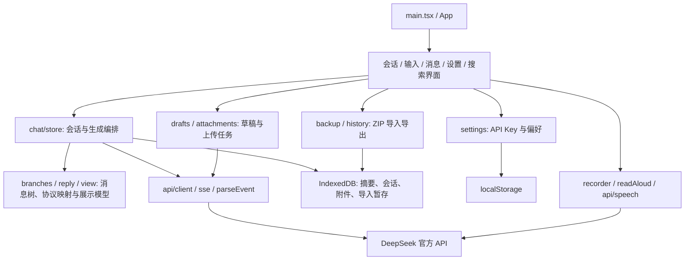

# 当前项目设计与 Android 差距分析

审查日期：2026-11-17（Asia/Singapore）  
代码基线：`develop`，`5d5dd75`（`fix: clarify history import errors and release v0.1.1`），应用版本 `0.1.1`。

本文基于仓库源码、配置和已有历史格式说明进行静态审查。文中的“已实现”表示存在相应代码路径；不表示本轮已通过真实 DeepSeek 服务调用、浏览器交互或 Android 真机验收。本文不修改应用代码。

## 1. 项目定位与总体判断

当前项目是一个 **React + TypeScript 的无应用后端 Web 聊天客户端**。它已有移动端响应式布局，但没有 Android 原生工程、安装包或原生平台适配层。用户自行输入 API Key，浏览器直接请求 DeepSeek；会话与附件原件保存在本地浏览器存储。

这份基线已经接入较新的应用 API：Anthropic 兼容 Messages / Files、联网搜索与阅读链接、语音转文字和语音合成。因此，后续重点应是核对并补齐协议覆盖、提高客户端可靠性、完成 Android 平台集成，而不是从零重做聊天界面。

核心证据：[`package.json`](../package.json) 的依赖与命令，`src/services/api/client.ts:13` 的 API 地址与 Anthropic 前缀，`src/services/api/speech.ts:9` 的语音地址，`src/services/chat/store.ts:36` 的默认模型。

## 2. 技术栈与模块边界

| 层次 | 当前组成 | 职责及证据 |
| --- | --- | --- |
| 入口与应用外壳 | React 18.3.1、React DOM | `src/main.tsx:8` 初始化 KaTeX、主题并挂载 `App`；`src/app/App.tsx:29` 组织侧栏、会话、搜索面板、设置和 Toast |
| 界面与样式 | TSX、CSS Modules、全局主题变量 | `src/components/` 按聊天输入、消息、搜索、会话、侧栏、设置、基础控件划分 |
| 响应式与主题 | `matchMedia`、`visualViewport`、Zustand | `src/app/viewport.ts:4` 的 768px 断点；`src/app/theme.ts:64` 初始化系统主题监听 |
| 全局状态 | Zustand 4.4.7 | 设置、会话、草稿、上传任务、朗读状态分别维护，未使用统一依赖注入或平台服务接口 |
| API 传输 | 浏览器 `fetch`、`ReadableStream`、`AbortController` | `src/services/api/client.ts:69` 统一 HTTP 请求；SSE 解码与消息校验分层实现 |
| 聊天领域 | `services/chat` | 会话列表/详情缓存、分支树、消息上下文、生成状态、持久化与备份 |
| 本地数据 | `idb` 8.0.3、IndexedDB、localStorage | `src/services/chat/db.ts:57` 打开 `chat-demo` 数据库；`src/services/settings.ts:33` 读写设置 |
| 富文本 | mdast / micromark、Prism、KaTeX、Mermaid | 解析层与 React 渲染层分离，部分重型依赖动态加载 |
| 归档 | `fflate` 0.8.3、自定义 ZIP 读写 | 官方历史会话风格的格式版本 3，支持完整消息树和部分附件 |
| 构建 | Rspack 2、SWC、Lightning CSS、TypeScript 严格检查、oxlint / oxfmt | `rspack.config.ts:27`；`package.json:8`；`tsconfig.json` |

依赖版本以当前锁文件和 `package.json` 为准。仓库没有服务端程序、账号系统、服务端会话存储或云同步实现；这些均不能从“可使用 DeepSeek API”推导为已具备。

### 2.1 结构关系

`store.ts` 同时承担领域编排、网络调用和浏览器生命周期处理，且文件较大。Android 适配若直接把原生调用散落到这里，会继续增加耦合；适合先抽出传输、凭据、存储、录音播放和文件交互等接口。

## 3. 启动、状态与发送流程

1. `src/main.tsx:8` 预热 KaTeX、初始化主题并渲染应用。
2. `src/app/App.tsx:60` 绑定上传通知与会话保存；启动 `initChat()`，并检查是否需要展示 API Key 设置。
3. `src/services/chat/store.ts:291` 加载会话摘要；会话正文在选中时由 `ensureSessionLoaded()` 按需读取。不存在完整消息全部常驻内存的设计。
4. `src/services/chat/drafts.ts:61` 添加附件时先整批校验、建立预览并立即上传；`prepareDraftMessage()` 要求所有附件上传完成后才允许发送。
5. `src/services/chat/store.ts:548` 的 `sendMessage()` 读取最新草稿，必要时新建会话，向当前分支追加提问与待生成回答，保存附件原件并清空已发送草稿。
6. `src/services/chat/store.ts:962` 的 `streamReply()` 补传缺失的文件 ID、生成本轮信息快照、构造请求并消费 SSE；增量按动画帧合并到状态。
7. `src/services/chat/reply.ts:72` 按事件追加正文、思考、签名、引用和服务端工具块；完成、停止、失败分别收尾，再保存会话。

`streaming` 按会话 ID 保存 `AbortController`，同一会话生成时不能再次发送或切换分支，不同会话可分别拥有生成任务。停止操作通过 `abort()` 结束本次生成；发送前共用的附件上传任务不一定随生成停止而取消，成功结果仍可写回会话（`store.ts:816`）。

## 4. API 协议与实际使用范围

### 4.1 已有请求入口

默认源地址在构建时由 `__API_ORIGIN__` 注入，为 `https://api.deepseek.com`。当前 UI 不提供运行时切换服务地址。Rspack 的 `createConfig({ apiOrigin, devServer })` 允许定制构建及开发代理（`rspack.config.ts:19`）。

| 用途 | 当前请求 | 鉴权与行为 | 实现证据 |
| --- | --- | --- | --- |
| 校验 API Key | `GET /models` | `Authorization: Bearer`；只判断请求成功，不读取并动态展示模型列表 | `src/services/api/client.ts:93` |
| 流式聊天 | `POST /anthropic/v1/messages` | `x-api-key`；`stream: true`；期望 `text/event-stream` | `src/services/api/client.ts:144` |
| 上传附件 | `POST /anthropic/v1/files` | `x-api-key`、`anthropic-beta: files-api-2025-04-14`；multipart | `src/services/api/client.ts:105` |
| 删除远端文件 | `DELETE /anthropic/v1/files/{id}` | 有客户端函数，但正常删除会话不调用它 | `src/services/api/client.ts:126`；`src/services/chat/db.ts:126` |
| ASR | `POST /v1/tools/asr` | Bearer；上传 WAV；一次取得转写文本 | `src/services/api/speech.ts:17` |
| TTS | `POST /v1/tools/tts` | Bearer；请求 PCM 字节流 | `src/services/api/speech.ts:49` |

联网搜索和阅读链接通过聊天请求内的 `deepseek_web_search`、`deepseek_read_url` 服务端工具调用，不是客户端直接调用独立 Search / Fetch API。仓库没有独立 Responses、Chat Completions、OCR、余额查询或远端文件列表/内容管理的完整封装；是否纳入产品取决于用途，不能把“全量 API 文档已归档”误记为“客户端全部 API 已实现”。

### 4.2 请求固定项与用户可配置项

- 默认模型固定为 `deepseek-flash`（`store.ts:36`）。类型层支持 `deepseek-v4-pro`，但没有模型选择 UI，也没有运行时能力发现。
- 深度思考和智能搜索由设置切换（`settings.ts:90`）；`thinking` 发为 enabled / disabled，没有思考强度、生成长度等高级参数控制。
- `deepseek_read_url` 始终声明，智能搜索开关只增减 `deepseek_web_search`（`store.ts:49`）。
- `safety_check: { level: 'high' }` 固定开启，因此代码注释认为所有聊天均进入扩展模式（`store.ts:42`）。
- 系统提示固定为 DeepSeek 助手身份；无用户自定义系统提示管理（`store.ts:38`）。
- 空标题会话请求 `title.enabled`，从 `message_delta` 中取得标题；手动重命名后取消覆盖资格（`store.ts:962`）。
- `latest_reminder` 是扩展角色：日期、星期、手动位置、平台标记 `Web`、语言。快照随回答保存；续写沿用原快照（`src/services/chat/latestReminder.ts:19`）。Android 版应调整平台标记，并核对正式协议要求。

### 4.3 SSE、错误与重试

`src/services/api/sse.ts:23` 的解码器处理 UTF-8 跨分片、CRLF / CR / LF、空行派发、多行 data、注释和事件 ID。它不实现 EventSource 自动重连。`parseEvent.ts:175` 再对 JSON 对象做有限运行时校验；无法识别的事件或块会跳过。

`client.ts:144` 处理 HTTP 错误、流内错误、响应类型错误及未收到 `message_stop` 的断流；`store.ts:962` 在已收到结束原因但缺终止帧时仍可收尾为完成。UI 按鉴权、余额、限流、服务繁忙等类别提示（`src/services/api/errors.ts:17`、`src/services/chat/describe.ts:19`）。

自动重试针对 **未收到内容块时发生的文件 ID 失效**：清除相关服务端 ID、从本地补传并最多重试两次，使用退避等待（`store.ts:44`、`:900`、`:941`）。它不是通用网络自动重连或续传机制，也没有持久化任务队列、断点恢复游标或原生后台任务。

### 4.4 与本次官方快照核对后的协议差距

以下结论对照了本地 [2026-11-17 官方文档快照](deepseek-api/snapshot-2026-11-17/INDEX.md)。它们是静态契约核对，不等于已复现真实请求故障。

**过时的 document 注释。** `src/services/api/types.ts:130` 记载“扩展模式不支持 document，返回 400”，与当前官方契约不符。归档的 [Anthropic API 指南](deepseek-api/snapshot-2026-11-17/source/zh-cn/guides/anthropic_api.md) 第 150 行明确支持 user 消息中 `document` 的 file / text 来源；[文件解析指南](deepseek-api/snapshot-2026-11-17/source/zh-cn/guides/document_parsing.md) 的“文档问答”段也说明，开启安全审核后会审核 `rich_layout_recognition` 裁出的图片。因此该注释应在实现阶段更新，不能据此判断 document 和安全检查不能组合。当前应用实际参数组合及服务行为仍未通过真实 API 验证。

**多轮回复没有按官方推荐完整回传。** [联网工具指南](deepseek-api/snapshot-2026-11-17/source/zh-cn/guides/web_tools.md) 第 437 行要求将每轮回复原样回传并保留 `kind` / `signature`；[Messages 参考](deepseek-api/snapshot-2026-11-17/source/zh-cn/api/create-message.md) 的 messages / assistant / thinking 定义也要求保留内容块及思考签名。现有 `reply.ts:223` 会省略历史思考、搜索和深度搜索工具块，重新合并正文，并只回传 read_link 调用与结果，因而与“完整回传”的契约建议有静态差距。另一方面，联网工具指南第 439 行又明确历史思考、搜索结果和深度搜索打开的网页不会进入下一轮模型上下文；不能从过滤代码直接推导为必然 400 或已经丢失应参与上下文的搜索正文。实现阶段应保存并原样序列化官方支持的响应块，用协议样本和真实多轮调用验证。

**read_link 签名路径基本符合核心要求。** `parseEvent.ts:138` 保留字符串签名，`reply.ts:230` 排除无有效签名的成功结果，`:277` 将保留的结果块原样放回请求。按联网工具指南第 441 行，没有有效签名时网页不会恢复到上下文，请求仍可执行。已有路径未发现主动改写有效网页签名的逻辑，但导入导出、分支切换、继续生成等组合尚未通过真实调用验证。思考模式中继续客户端工具调用需要完整回传 thinking / tool_use / tool_result（Anthropic 指南第 139 行）；当前没有客户端工具执行循环，应在未来扩展时单独实现，不能直接复用“只保留回答正文”的历史过滤策略。

**附件限制没有覆盖请求级聚合约束。** 当前前端 50 个附件、默认 64 MiB 的限制，是 Demo 自身策略，不能等同于最新全部服务限制。文件解析指南要求每个请求最多引用 20 个文档、文档文字合计最多 8 MiB，且历史引用也会进入上下文；文档解析上传现列 100 MiB 上限，图片 file_id 则有另外的 64 MiB 规则。现有 `validateFiles()` 只检查当前草稿的格式、单文件大小和数量，没有聚合当前分支历史中的文档数、解析文本和图片总量。实现阶段应区分上传限制、当前草稿限制、最终请求限制，并对服务端无法预知的解析后体积错误作明确反馈。

## 5. 会话树、上下文与本地数据

### 5.1 领域模型

`src/services/chat/types.ts` 将会话存为包含全部分支的消息数组。消息用 `parentId` / `selectedChildId` 表达树关系，会话 `rootMessageId` 指向当前根。旧的线性数据可在内存规范化为单分支（`branches.ts:4`）。

- 编辑提问新增兄弟版本；重新生成在同一提问下新增回答，不覆盖旧消息与后续对话（`store.ts:619`、`:645`）。
- 界面与 API 上下文共用当前选中路径（`branches.ts:19`）。
- 上下文只保留“提问 + 有正文、已完成/停止且非拒绝、非模板回答”的成对轮次；错误、空回答等轮次不回传（`reply.ts:197`、`:287`）。
- 历史思考和搜索块不回传；成功阅读链接的结果需要保留签名供服务端恢复页面内容（`reply.ts:223`）。
- 续写只允许末条满足条件的停止/长度上限回答；拒绝、客户端工具、服务端工具、模板、导入消息受到限制（`reply.ts:172`、`store.ts:689`）。
- 客户端 `tool_use` 可被识别，但没有通用客户端工具执行循环，会使回复不可续写（`reply.ts:88`）。

### 5.2 持久化与内存

| 数据 | 存储 | 关键边界 |
| --- | --- | --- |
| API Key、语言、主题、位置、音色、思考/搜索及侧栏设置 | localStorage | API Key 为明文字符串；读写失败时退回仅内存生效，没有持久化失败提示（`settings.ts:33`） |
| 会话摘要 | IndexedDB `sessionSummaries` | 列表只读摘要；附带文件引用索引用于清理未被引用的本地原件 |
| 会话全文与消息树 | IndexedDB `sessions` | 当前详情按需读取；缓存目标上限 5，当前、生成中、未保存、删除中的会话不淘汰，因此不保证硬上限（`store.ts:40`、`:122`） |
| 本地附件原件 | IndexedDB `files` | 本地 ID 共享原件，和远端 `serverId` 分离；会话删除仅清理无引用的本地文件 |
| 导入暂存 | IndexedDB `sessionsStaging`、`filesStaging` | 完整校验后同一事务替换正式会话、摘要、文件，失败保留旧正式数据 |
| 未发送草稿、上传任务、生成控制器 | 内存 | 页面/进程销毁后不恢复；草稿按会话 ID 隔离（`drafts.ts:27`） |

数据库版本为 11（`db.ts:5`），升级回调创建缺失存储与索引，明确没有旧消息格式迁移器。后续变更需要制定迁移与回滚策略。

保存失败会保留未保存状态及附件原件，并提供重试（`store.ts:182`、`App.tsx:81`）。`visibilitychange` / `pagehide` 尽力合并增量并保存（`store.ts:228`）；这不保证 Android 强杀前能收到事件或完成异步事务。重开会话时将 pending / streaming 回复转为 stopped（`store.ts:273`）。

## 6. 附件、语音与富文本

### 6.1 附件

`src/services/attachments.ts:13` 设置每批累计最多 50 个附件、默认 64 MiB、`user_data` 32 MiB、同时上传 3 个。前端按扩展名白名单、大小及数量校验，MIME 缺失时只对若干图片格式补齐。

图片上传不传 purpose；PDF / Word / PowerPoint 使用 `rich_layout_recognition`，其他非图片文件使用 `user_data`（`attachments.ts:29`）。上传状态、重试和配额通知独立于会话管理。取消草稿附件会取消上传并释放预览，但未形成用户可操作的远端文件管理功能。

`src/components/messages/MessageFile.tsx` 依赖本地 Blob URL 展示和打开文件，`window.open()` 不等同于 Android 文件查看 Intent；导入/导出和文件选择也仍是浏览器交互。

### 6.2 语音

录音通过 `getUserMedia()` 与 Web Audio，在 16kHz 单声道下以 `ScriptProcessorNode` 采集，编码 16-bit PCM WAV，最长 120 秒（`src/services/speech/recorder.ts:7`、`:23`）。录音结束后一次上传 ASR，不是实时语音对话；频谱来自 `AnalyserNode`。

朗读从 TTS 取得 24kHz、单声道、16-bit little-endian PCM，边接收边排程 AudioContext 播放，切换会话会停止；音色为 stella / tide（`speech/readAloud.ts:80`、`api/speech.ts:11`）。没有 Android 音频焦点、耳机/蓝牙路由、锁屏媒体控制、后台播放或录音生命周期集成。

### 6.3 展示

- `src/services/markdown/parse.ts:34` 生成 Markdown AST，支持 GFM 与数学；引用标记转为来源节点。
- `src/components/markdown/MarkdownAstRenderer.tsx:16` 将普通 HTML 按文字处理，只有简单 br 渲染换行；Markdown 图片显示为链接（`Link.tsx:49`）。
- Prism 按语言加载高亮，KaTeX 处理公式，Mermaid 按顺序绘制并使用 strict 安全模式（`services/markdown/mermaid.ts:21`）。
- `src/components/markdown/useThrottleMarkdownRender.ts:14` 依据渲染耗时节流，最长等待 2 秒；避免每个 token 都重绘全部富文本。
- `src/services/chat/view.ts:176` 把块转为思考、搜索、打开页面、页内查找、读链接和正文展示模型；搜索结果及引用面板已有组件。
- `src/components/messages/MessageList.tsx:145` 使用普通 `messages.map` 渲染当前路径全部消息，未做虚拟列表。长对话与重图表内容的性能仍需实际测量。

## 7. 历史导入导出及迁移边界

入口为 `src/services/chat/backup.ts:20`，格式版本为 3（`history/format.ts:12`）；详细规则见 [`src/services/chat/history/README.md`](../src/services/chat/history/README.md)。

导入、导出、全部删除通过串行队列避免冲突。导入先检查 ZIP 首条 manifest，再停止生成、锁定修改、逐条写暂存，完成索引、消息树、附件、ZIP 完整性校验后原子替换正式数据。导出保留开始时的列表与已加载会话快照，未打开会话逐条读取。

归档保存完整消息树、当前分支和本地可用图片原件，**不保存非图片附件原件**。API Key、应用设置、模型、用量、正文引用角标、思考签名、结构化错误、`latestReminder` 等也不会完整保留。未知类型片段会丢弃。它是兼容历史的交换格式，不能充当完整、无损的应用备份。

ZIP 支持单卷 ZIP32 STORE / DEFLATE，不支持 ZIP64、加密、分卷。导出最终生成完整 Blob，大历史可能产生明显内存压力。界面通过 `a.download` 下载（`SettingsDialog.tsx:527`）；Android 版需要系统文件选择与保存路径，并明确正式升级备份和“导入覆盖全部”的用户预期。

没有官方账号登录、自动抓取官方客户端数据库或持续云同步的代码。现有官方历史迁移路径是用户提供可识别的导出 ZIP；当前实现的兼容声明仍需真实导出样本验证。

## 8. 移动端已有工作与 Android 缺口

已经具备：窄于 768px 的侧栏抽屉和移动顶栏，键盘可视视口跟随，阻止整页滚动而保留内部滚动，部分 safe-area CSS，流式回答跟随底部和切换分支滚动锚定（`viewport.ts:46`、`MessageList.tsx:72`）。

| Android 需求 | 当前状态 | 后续需要解决的问题 |
| --- | --- | --- |
| APK / AAB、应用 ID、签名、版本升级 | 无工程 | 选择应用容器/原生路线并建立可复现构建、签名与安装流程 |
| 系统返回键、预测性返回、状态栏/导航栏、横屏 | 无原生桥接 | 抽屉/弹窗/搜索面板/返回退出的优先级、边到边布局和输入法协调 |
| 凭据保管 | 明文 localStorage | Keystore 支持的凭据存储、卸载/备份规则、迁移及清除行为；避免把共享密钥打包进 APK |
| 网络与 SSE | 浏览器 fetch | 验证 WebView CORS、请求头、长流、证书/代理、取消；必要时实现保持流式语义的原生传输接口 |
| 生命周期 | pagehide / visibilitychange 尽力保存 | 前后台切换、旋转重建、进程回收、强杀恢复及未发送草稿持久化 |
| 录音/朗读 | Web Audio | 原生权限申请和拒绝恢复、音频焦点、来电/耳机中断；明确后台策略 |
| 附件及备份 | input / Blob URL / a.download | 系统内容 URI、文件选择/保存/分享/打开、临时文件与大文件内存 |
| 存储与升级 | IndexedDB，缺少旧格式迁移 | 固定 WebView origin、升级保留、容量/失败处理；是否迁至 SQLite 应以验证结果决定 |
| 消息性能与可访问性 | 普通列表，基础 ARIA | 低端设备长对话、TalkBack、字号/触控/对比度、输入法及图表性能验收 |
| 账号与官方体验 | API Key + 本地会话 | API 付费与官方账号服务的差别；不应把“替代日常使用”写成官方功能或账单完全等价 |

此表是源码差距分析，不是安全扫描或已验证的 Android 缺陷列表。Android 平台和选型的具体规范应以当前官方平台文档及后续技术验证为准。

## 9. 工程与验证现状

- 仓库有类型检查、lint 和 Web 构建命令，未发现测试目录、测试命令、自动协议/浏览器/Android 测试或 Android 构建配置。
- `.github/workflows/pages.yml:3` 只在 main 推送或手动触发，执行 frozen-lockfile 安装、type、lint、build，并部署 GitHub Pages；develop 没有独立 PR/推送质量门禁。
- `package.json:10` 的 build 使用 POSIX `rm -rf` 和 `NODE_ENV=production` 前缀；直接由 Windows 默认命令解释器运行存在兼容性问题。Rspack 已配置 `output.clean: true`，后续可改造为跨平台入口。本文没有运行这个删除式脚本。
- `rspack.config.ts:8` 的浏览器转译目标包含 Chrome >=105 等，不等于已声明并验证 Android 最低系统/WebView 支持矩阵。
- MIT 许可证已有构建复制，后续 APK 分发还需汇总依赖许可；本轮没有执行许可审计。

本设计审查没有安装依赖、调用付费 API、构建 APK 或操作真机。后续验证结果请记录到独立验证报告，并区分静态通过、模拟协议通过、真实 API 通过和 Android 真机通过。

## 10. 可供改进方案复用的结论

保留现有 React 界面、消息树、协议解析、Markdown 和历史交换格式，有明显的复用价值。优先处理的架构边界是平台服务与聊天领域解耦、API 能力和模型配置、凭据与本地数据生命周期、语音/文件原生交互，以及最小可重复验证链。

本轮产出的改进方案应将“Android 容器/原生路线验证”“日常聊天闭环”“新增能力与体验补齐”“发布验收”分阶段列出；协议疑点、官方历史兼容、大文件和后台行为必须保留验证条件，不应先宣称已与官方 App 完全等价。
